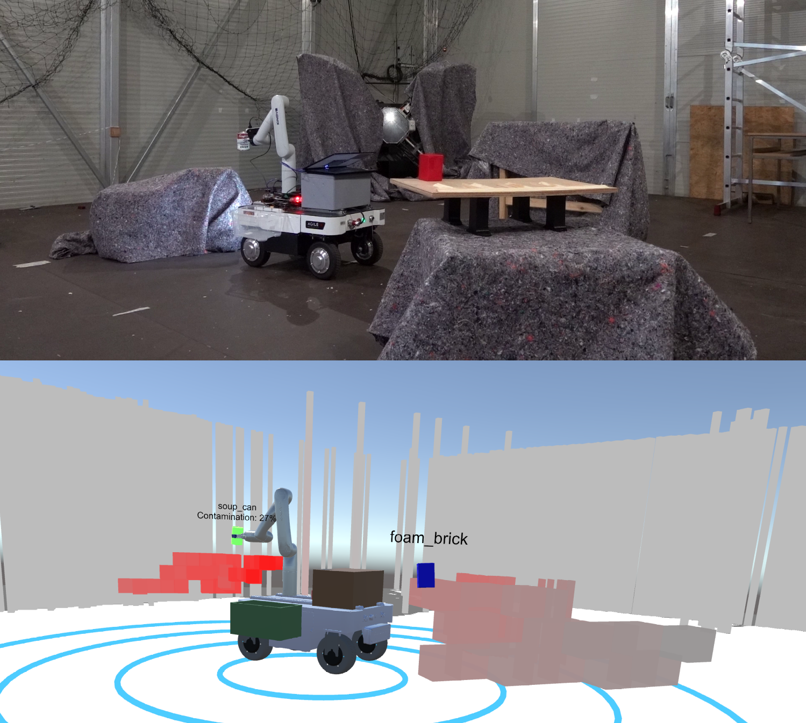
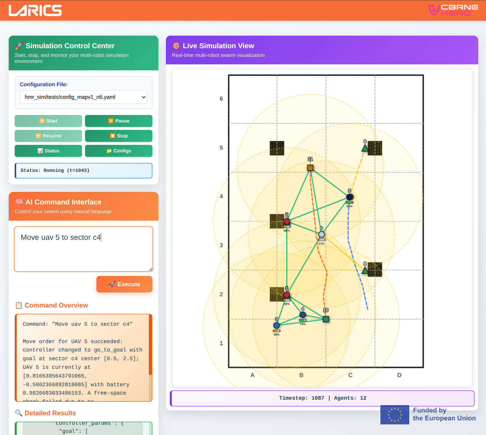
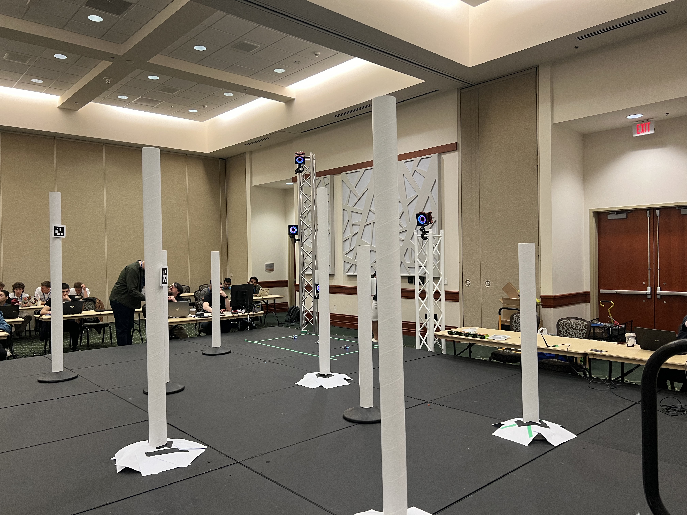
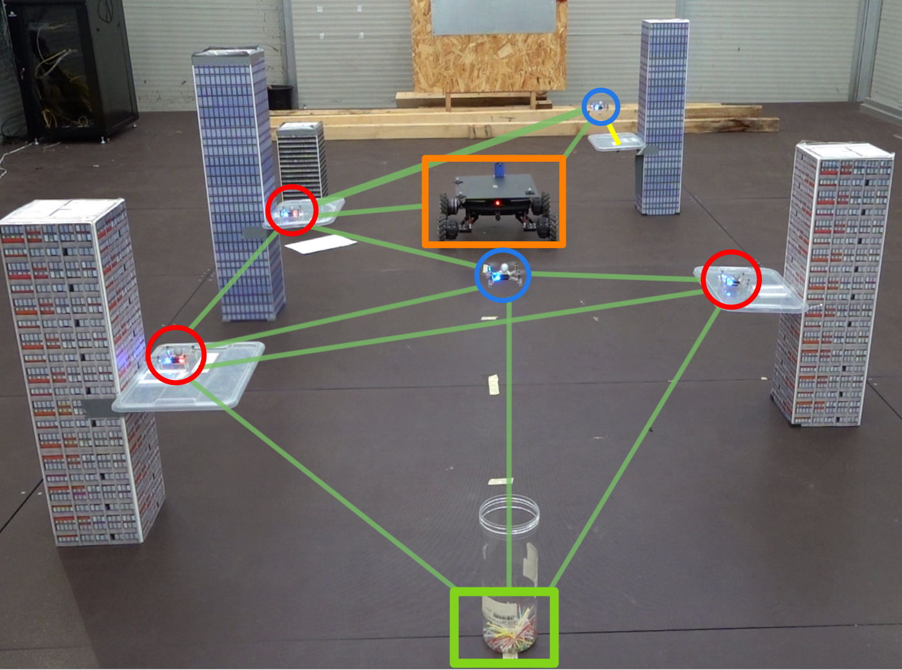
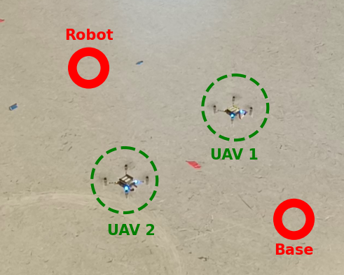
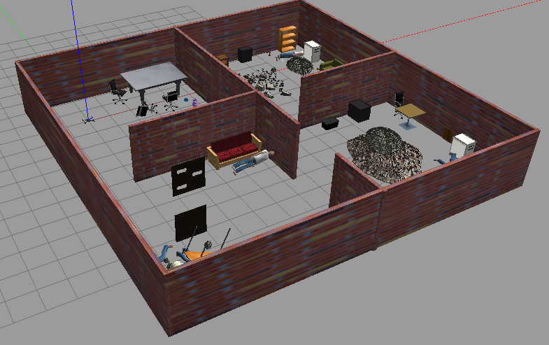
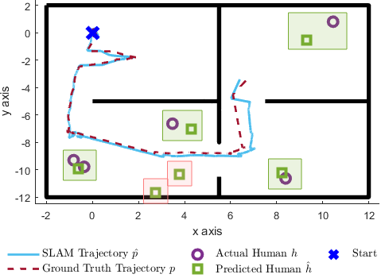

<header class="page-header">
  
$ ls ~/publications --sort=date --reverse

  <h1 class="page-title reveal delay-1">Publications.</h1>
  
Peer-reviewed papers and conference proceedings. Also indexed on <a href="{{ site.google_scholar }}" target="_blank">Google Scholar</a>.

</header>

<!-- ===========================================
     PUBLICATION TEMPLATE — copy to add a new entry (newest on top,
     bump the pub-index number):

     <article class="pub-card reveal">
       

         [08]
         
       

       

         
VENUE 'YY Full venue name

         <h3 class="pub-title">Paper Title</h3>
         
<strong>Khawaja G. Alamdar</strong>, Co-author 1, Co-author 2.

         

           <a href="PAPER_URL" class="btn btn-sm btn-primary" target="_blank"><i class="fas fa-file-pdf"></i> paper</a>
           <a href="VIDEO_URL" class="btn btn-sm" target="_blank"><i class="fas fa-video"></i> video</a>
           <a href="CODE_URL" class="btn btn-sm" target="_blank"><i class="fab fa-github"></i> code</a>
         

       

     </article>
     =========================================== -->

  <article class="pub-card reveal">
    

      [08]
      
    

    

      
RO-MAN '26 IEEE Int. Conference on Robot and Human Interactive Communication, Kitakyushu, Japan, pp. 936–942

      <h3 class="pub-title">I Spawn with My Little Eye: Low-Bandwidth Situational Awareness for CBRNE Response via Sparse Geometric Digital Twin of the Environment</h3>
      
Marko Kozlik, Elena Wachtler, <strong>Khawaja G. Alamdar</strong>, Karlo Cirkvencic, Frano Petric, Matko Orsag.

      

        <a href="https://ieeexplore.ieee.org/document/11714951" class="btn btn-sm btn-primary" target="_blank"><i class="fas fa-file-pdf"></i> paper</a>
      

    

  </article>

  <article class="pub-card reveal">
    

      [07]
      
    

    

      
ICUAS '26 Int. Conference on Unmanned Aircraft Systems, Corfu, Greece, pp. 1339–1346

      <h3 class="pub-title">LLM-Enabled Human-in-the-Loop Control of Multi-UAV Teams under Communication Constraints</h3>
      
<strong>Khawaja G. Alamdar</strong>, Frano Petric, Matko Orsag.

      

        <a href="https://ieeexplore.ieee.org/document/11598591" class="btn btn-sm btn-primary" target="_blank"><i class="fas fa-file-pdf"></i> paper</a>
      

    

  </article>

  <article class="pub-card reveal">
    

      [06]
      
    

    

      
ICUAS '26 Int. Conference on Unmanned Aircraft Systems, Corfu, Greece, pp. 704–711

      <h3 class="pub-title">Benchmarking Connectivity and Energy-Aware Algorithms Using Crazyflie UAVs: A Sim2Real Multi-Robot Framework</h3>
      
Marijana Peti, <strong>Khawaja G. Alamdar</strong>, Marko Kozlik, Antun Ivanovic, Frano Petric, Matko Orsag, Stjepan Bogdan.

      

        <a href="https://ieeexplore.ieee.org/document/11598653" class="btn btn-sm btn-primary" target="_blank"><i class="fas fa-file-pdf"></i> paper</a>
      

    

  </article>

  <article class="pub-card awarded reveal">
    

      [05]
      
    

    

      
<i class="fas fa-trophy"></i> best paper award MRS '25 IEEE Int. Symposium on Multi-Robot &amp; Multi-Agent Systems, Singapore

      <h3 class="pub-title">Perch-Aware Decentralized Control for Extending the Lifetime of UAV Communication Networks</h3>
      
<strong>Khawaja G. Alamdar</strong>, Marijana Peti, Frano Petric, Matko Orsag.

      

        <a href="https://ieeexplore.ieee.org/document/11357270" class="btn btn-sm btn-primary" target="_blank"><i class="fas fa-file-pdf"></i> paper</a>
        <a href="https://www.youtube.com/watch?v=u8JEi_p27BQ" class="btn btn-sm" target="_blank"><i class="fas fa-video"></i> video</a>
        <a href="https://github.com/larics/mrs_connectivity_perch" class="btn btn-sm" target="_blank"><i class="fab fa-github"></i> code</a>
      

    

  </article>

  <article class="pub-card reveal">
    

      [04]
      
    

    

      
IEEE ACCESS '25 vol. 13, pp. 83738–83751

      <h3 class="pub-title">Decentralized Battery-Aware Connectivity Maintenance for Multi-UAV Missions</h3>
      
<strong>Khawaja G. Alamdar</strong>, Tamara Petrovic.

      

        <a href="https://ieeexplore.ieee.org/document/11000322" class="btn btn-sm btn-primary" target="_blank"><i class="fas fa-file-pdf"></i> paper</a>
        <a href="https://youtu.be/tqGPNUnDRPA?si=s8bMwylB_hNAyk-t" class="btn btn-sm" target="_blank"><i class="fas fa-video"></i> video</a>
        <a href="https://github.com/KhAlamdar11/hmr_sim" class="btn btn-sm" target="_blank"><i class="fab fa-github"></i> code</a>
      

    

  </article>

  <article class="pub-card reveal">
    

      [03]
      
    

    

      
ROBIO '22 IEEE Int. Conference on Robotics and Biomimetics

      <h3 class="pub-title">Frontier Exploration for Disaster Management UAVs</h3>
      
<strong>Khawaja G. Alamdar</strong>, Mehdi R. Khorasani, S.M. Ali Rizvi, Rameen M. Ahmed, Junaid A. Memon.

      

        <a href="https://ieeexplore.ieee.org/document/10011693" class="btn btn-sm btn-primary" target="_blank"><i class="fas fa-file-pdf"></i> paper</a>
        <a href="https://www.youtube.com/watch?v=EyEW8sv9_-g" class="btn btn-sm" target="_blank"><i class="fas fa-video"></i> video</a>
      

    

  </article>

  <article class="pub-card reveal">
    

      [02]
      
    

    

      
ICRCV '22 IEEE Int. Conference on Robotics and Computer Vision

      <h3 class="pub-title">Human Detection and Localization in Indoor Disaster Environments Using UAVs</h3>
      
S.M. Ali Rizvi, Rameen M. Ahmed, <strong>Khawaja G. Alamdar</strong>, Mehdi R. Khorasani, Junaid A. Memon.

      

        <a href="https://ieeexplore.ieee.org/document/9953174" class="btn btn-sm btn-primary" target="_blank"><i class="fas fa-file-pdf"></i> paper</a>
        <a href="https://www.youtube.com/watch?v=EyEW8sv9_-g" class="btn btn-sm" target="_blank"><i class="fas fa-video"></i> video</a>
      

    

  </article>

  <article class="pub-card reveal">
    

      [01]
      
    

    

      
VISAPP '22 VISIGRAPP

      <h3 class="pub-title">Mitigating the Zero Biased Steering Angles in Self-driving Simulator Datasets</h3>
      
M. Ammar Khan, <strong>Khawaja G. Alamdar</strong>, Aiman Junaid, Muhammad Farhan.

      

        <a href="https://www.scitepress.org/PublicationsDetail.aspx?ID=2Sz4o9GCxpU=&t=1" class="btn btn-sm btn-primary" target="_blank"><i class="fas fa-file-pdf"></i> paper</a>
        <a href="https://www.youtube.com/watch?v=cv-963rPr24" class="btn btn-sm" target="_blank"><i class="fas fa-video"></i> video</a>
      

    

  </article>

<!-- ===========================================
     ACCEPTED QUEUE — papers accepted but not yet published.
     When one is published: delete its acc-item here and add a
     full pub-card to the list on the left.
     =========================================== -->
<aside class="accepted-panel reveal">
  

    
    <h2 class="accepted-title">accepted_queue</h2>
  

  
// accepted &middot; awaiting publication

  <!-- ACCEPTED ITEM TEMPLATE — replace the acc-note below with one or more of:
  

    
VENUE 'YY

    <h3 class="acc-name">Paper Title</h3>
    
<strong>Khawaja G. Alamdar</strong>, Co-author 1, Co-author 2.

  

  -->
  
// queue empty &mdash; all caught up

</aside>

